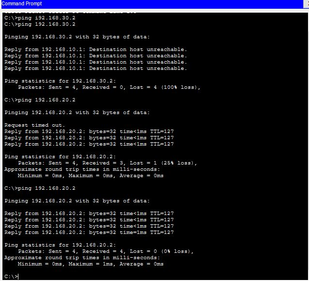
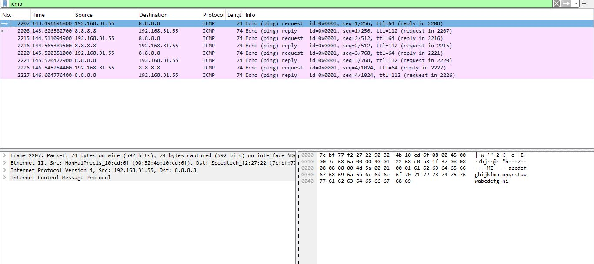
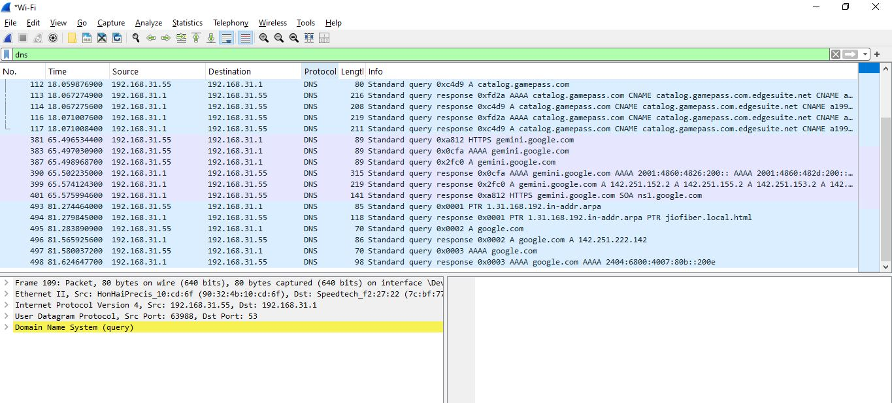
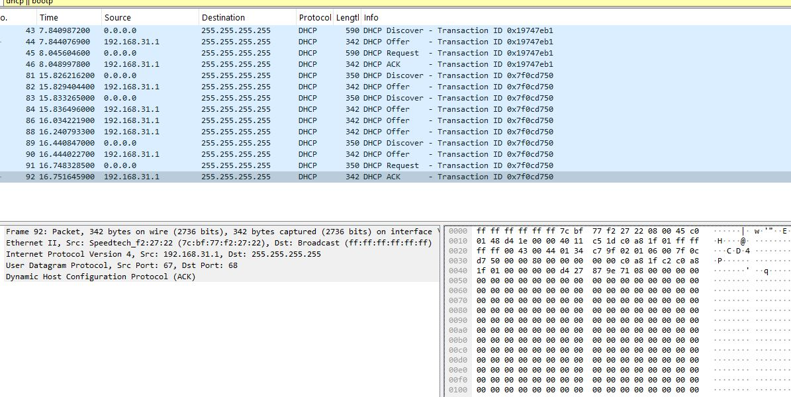

# Enterprise Multi-VLAN Network Simulation & Protocol Analysis

A practical network deployment simulating departmental segmentation, inter-VLAN routing, dynamic IP addressing, and access control policies using Cisco Packet Tracer, validated via live packet inspection in Wireshark.

---

## 📌 Architecture & Design

The network segments an enterprise office environment into three isolated functional subnets connected via a single physical link through IEEE 802.1Q trunking (Router-on-a-Stick):

| Department | VLAN | Subnet | Gateway | Function |
| :--- | :--- | :--- | :--- | :--- |
| **Admin** | VLAN 10 | `192.168.10.0/24` | `192.168.10.1` | General Administration Workstations |
| **Operations** | VLAN 20 | `192.168.20.0/24` | `192.168.20.1` | Daily Operations Data Network |
| **IT Support** | VLAN 30 | `192.168.30.0/24` | `192.168.30.1` | Management & Secure Systems |

---

## ⚙️ Core Implementations

* **VLAN Segmentation (Layer 2):** Isolated switchports configured on a Cisco Catalyst 2960 switch to eliminate broadcast spillover across departments.
* **Router-on-a-Stick (Layer 3 Routing):** Sub-interfaces (`Gi0/0.10`, `.20`, `.30`) configured on a Cisco 2911 router with `encapsulation dot1Q` to route inter-departmental traffic.
* **Dynamic Addressing (DHCP):** Automated Cisco IOS DHCP multi-pool provisioning serving IP leases, subnet masks, default gateways, and DNS resolvers (`8.8.8.8`).
* **Access Control Lists (ACL Security):** Extended ACL applied to block the Admin subnet from accessing IT management infrastructure while preserving communication to Operations.

---

## 🔬 Test Evidence & Packet Verification

### 1. ACL Security Enforcement & ARP Cache Resolution
Verified security policies using ICMP echo requests from the Admin subnet (`192.168.10.x`):
* Pinging **IT Support (`192.168.30.2`)** is dropped by the default gateway returning `Destination host unreachable` (ACL 100 deny rule working as designed).
* Pinging **Operations (`192.168.20.2`)** demonstrates an initial ARP lookup timeout followed by 0% packet loss.

---

### 2. ICMP Protocol & TTL Inspection
Captured end-to-end IP reachability diagnostics to public DNS (`8.8.8.8`):
* Verified ICMP Type 8 (Echo Request) and Type 0 (Echo Reply) frame pairs.
* Inspected Time-to-Live (TTL) decrements across intermediate layer-3 hops.

---

### 3. DNS Recursive Name Resolution
Analyzed application-layer name resolution over UDP Port 53:
* Traced recursive queries for domains such as `google.com`.
* Confirmed authoritative IPv4 A-record (`142.251.222.142`) and IPv6 AAAA-record payload resolutions.

---

### 4. DHCP 4-Way DORA Handshake
Analyzed the dynamic lease acquisition process across broadcast interfaces over UDP ports 67/68:
1. **Discover:** Broadcast from `0.0.0.0` to `255.255.255.255`.
2. **Offer:** Unicast/broadcast configuration parameters from the gateway router (`192.168.31.1`).
3. **Request:** Formal client lease acceptance.
4. **ACK:** Confirmation of binding lease.

---

## 🛠️ Tools Used
* **Network Simulator:** Cisco Packet Tracer 8.x
* **Network Operating System:** Cisco IOS CLI
* **Packet Analyzer:** Wireshark
* **Host Diagnostics:** Windows Command Prompt (`ping`, `ipconfig`, `nslookup`, `arp`)
